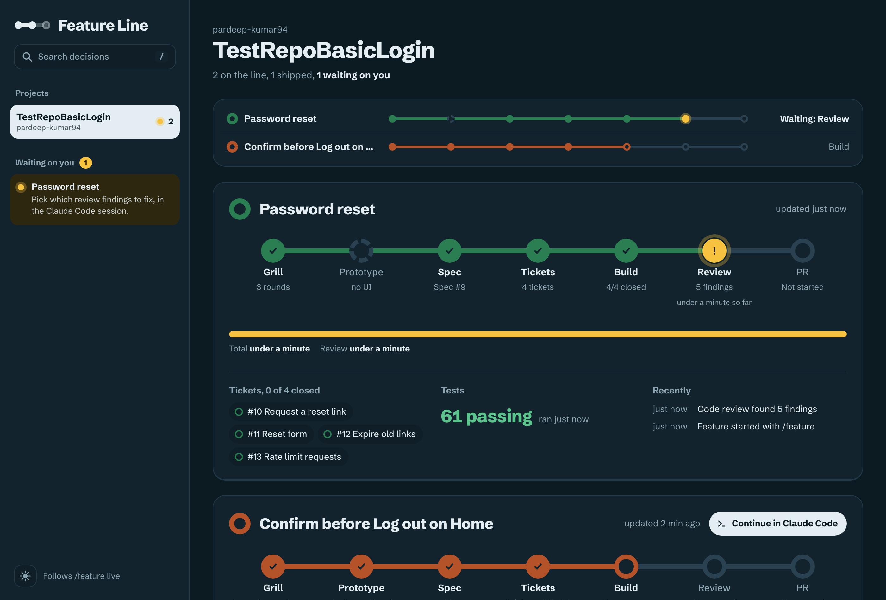

# claude-idea-to-pr

A Claude Code skill that takes a feature from idea to merged PR in a fixed order, with a live local board to follow it on.

```
/feature password reset
```

Each run picks up wherever the feature stands, and it stops only for decisions that belong to you.

| # | Stage | Runs | Stops for you |
|---|---|---|---|
| 1 | Grill | `/grill-with-docs` | each round's answers |
| 2 | Prototype | `/prototype` (skipped when there's no UI) | picking the variant |
| 3 | Spec | `/to-spec` | the seam check |
| 4 | Tickets | `/to-tickets` | approving the breakdown |
| 5 | Build | `/implement` with `/tdd`, one ticket at a time | — |
| 6 | Review | `/code-review` | which findings to fix |
| 7 | PR | `/pr`, then push and open the PR | before any push, and the merge |

It never pushes, opens a PR, creates issues or comments on GitHub until you say yes in the conversation.

## The Feature Line board

A local page that shows every feature as a line of seven stations, across all your projects. It refreshes every few seconds while `/feature` runs.



```
node ~/.claude/skills/feature/scripts/board.mjs open
```

- **Waiting on you:** everything that needs your answer, across projects.
- **Tap a station** to see what was decided there: grilling answers, glossary entries, ADRs, variants, tickets and review findings.
- **Search** (`/`) across every recorded decision.
- **Continue in Claude Code** reopens the feature's folder with `/feature` ready to send, and each past session has a copyable `claude --resume` command.

The board's data is stored in `board/features/` inside the skill folder. It stays on your machine, and git ignores it.

## Install

1. Install the stage skills from [mattpocock/skills](https://github.com/mattpocock/skills): `grill-with-docs`, `prototype`, `to-spec`, `to-tickets`, `implement`, `tdd`, `code-review`, `pr` and `setup-matt-pocock-skills`.
2. Clone this repo into a folder named `feature`:

   ```
   git clone https://github.com/pardeep-kumar94/claude-idea-to-pr.git ~/.claude/skills/feature
   ```

   The folder must be named `feature`: the skill refers to its scripts by that path.

You also need:

- **Node.js 18 or later**, for the board script.
- **The [GitHub CLI](https://cli.github.com/), signed in (`gh auth login`)**: the skill reads issue, sub-issue and PR state with it.

## Usage

- `/feature <idea>` starts a feature, or resumes the open one that matches.
- `/feature` on its own continues the feature in progress, or asks which one if several are open.
- In a repo without `docs/agents/`, the first run starts with `/setup-matt-pocock-skills`.

## Files

- `SKILL.md`: the stages and the rules Claude follows.
- `BOARD.md`: the board's data format and the `board.mjs` commands.
- `scripts/board.mjs`: the only way the board's data is written.
- `scripts/github-state.sh`: prints a spec's tickets and PRs from GitHub, so the board can be checked against them.
- `board/index.html`: the board page. It opens straight from disk and needs no server.

## License

[MIT](LICENSE)
